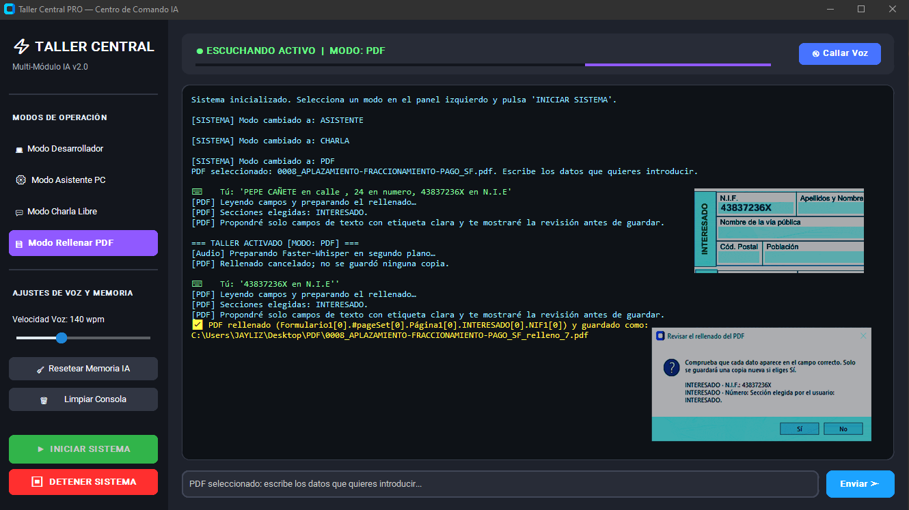

# 🛠️ Taller Central - Asistente Modular Offline (Windows) 

Asistente de escritorio modular, 100% offline y diseñado para entornos de desarrollo de alto rendimiento en Windows (optimizado para equipos con 16 GB de RAM), utilizando modelos locales para mantener total privacidad y escapar de bloqueos de API en la nube.

<table width="100%">
  <tr>
    <td align="left" width="75%">
      
    </td>
    <td align="center" width="25%">
      
      <br><br>
      
    </td>
  </tr>
</table>

<p align="center">
  
  
  
  
  
</p>

---

## 🚀 Arquitectura Modular (Anti-Crashes)

El proyecto está estructurado en varios archivos independientes para aislar los hilos en segundo plano y evitar que fallos de hardware o audio congelen la interfaz gráfica:

| Módulo | Descripción Técnica |
| :--- | :--- |
| **`main.py`** | Núcleo visual construido con **CustomTkinter**. Gestiona los modos, la consola de logs y los hilos seguros de ejecución. |
| **`audio_engine.py`** | Motor de transcripción offline con **Faster-Whisper** (`int8`/`float16`), detección automática de silencio (VAD) con `sounddevice`/`numpy` y *prompting* de vocabulario técnico. |
| **`gestor_voz.py`** | Gestor asíncrono de síntesis de voz (`GestorVozAsync`) con cola de frases en streaming en tiempo real, interrupción instantánea y aislamiento COM (`pyttsx3` / SAPI5). |
| **`ollama_client.py`** | Cliente de integración local con **Ollama** (`Qwen 2.5 Coder`), chat en streaming, ventana ampliada de **8192 tokens** (`num_ctx`), lectura de portapapeles (`pyperclip`) y autoevaluación. |
| **`pdf_engine.py`** | Lee campos AcroForm, sincroniza datos XFA cuando existen y guarda una copia; conserva el original. |
| **`acciones_pc.py`** | Automatización y control de ventanas de Windows mediante **PyAutoGUI** y comandos del sistema. |

---

## 🎯 Modos de Operación

- **💬 Modo Charla**: Conversación fluida con la IA para resolución de dudas rápidas.
- **⚙️ Modo Asistente**: Control por voz de aplicaciones de Windows, carpetas y búsquedas web.
- **💻 Modo Desarrollador**: Puede usar el código del portapapeles como contexto y copia el resultado al portapapeles.
- **📄 Modo Rellenar PDF**: Selecciona un PDF interactivo, dicta o escribe los datos, elige por voz o en pantalla entre secciones duplicadas como Interesado y Representante, revisa la correspondencia y confírmala antes de guardar una copia `nombre_relleno.pdf`.

Cada modo de IA tiene instrucciones propias: desarrollo entrega código, charla responde para voz y PDF devuelve datos estructurados sin inventar información. El control del PC usa comandos directos.

El modo PDF necesita campos interactivos AcroForm. Para evitar asignaciones dudosas, la IA solo propone campos de texto con etiquetas legibles; casillas y opciones quedan intactas. El PDF escaneado o plano requiere OCR y posicionamiento de texto.

---

## 📋 Requisitos e Instalación

1. Tener instalado **Python** y **Ollama** corriendo localmente (`http://localhost:11434`) con el modelo `qwen2.5-coder:7b`.
2. Instalar las dependencias de Python necesarias ejecutando:
   ```bash
   pip install customtkinter faster-whisper numpy sounddevice pyttsx3 pywin32 pyperclip pyautogui requests
   ```
3. *(Opcional)* En el primer arranque, **Faster-Whisper** descargará y guardará en caché local el modelo `small` automáticamente; a partir de ahí funcionará **100% offline** (`local_files_only=True`).
4. Arrancar el taller ejecutando:
   ```bash
   python main.py
   ```


<p align="center">
  
  &nbsp;&nbsp;
  
  &nbsp;&nbsp;
  
</p>

---

## 📂 Estructura del Proyecto

```text
Asistente-Modular/
│
├── 📄 main.py              # Núcleo visual (CustomTkinter)
├── 📄 audio_engine.py      # Reconocimiento de voz offline (Faster-Whisper + VAD)
├── 📄 gestor_voz.py        # Cola asíncrona de voz y streaming TTS (pyttsx3 / SAPI5)
├── 📄 ollama_client.py     # Conexión local con Ollama (Qwen 2.5 Coder)
├── 📄 acciones_pc.py       # Automatización de Windows (PyAutoGUI)
└── 📄 README.md            # Documentación oficial del taller
```

---

## 📥 Clonar el Repositorio

Si quieres clonar este taller directamente en tu estación de trabajo, abre tu terminal y ejecuta:

```bash
git clone [https://github.com/Jaypsmall/Asistente-Modular.git](https://github.com/Jaypsmall/Asistente-Modular.git)
cd Asistente-Modular
```

---

## 👨‍💻 Autoría y Colaboración

<div align="center">

<h3>👨‍💻 Autoría y Colaboración</h3>

<p>
  Proyecto creado y mantenido por <a href="https://github.com/Jaypsmall"><b>Jaypsmall</b></a><br>
  <i>Desarrollo modular open-source para entornos de alta eficiencia.</i>
</p>

<a href="https://github.com/Jaypsmall">
  
</a>
&nbsp;
<a href="https://github.com/Jaypsmall/Asistente-Modular/pulls">
  
</a>

<br><br>
<sub><i>¡Las pull requests, optimizaciones de hilos y nuevas herramientas para este asistente offline son totalmente bienvenidas! 🚀</i></sub>

</div>

---

## 📄 Licencia

Este proyecto se distribuye bajo los términos de la licencia **MIT**. Siéntete libre de usarlo, modificarlo y adaptarlo a tus necesidades en el taller.
